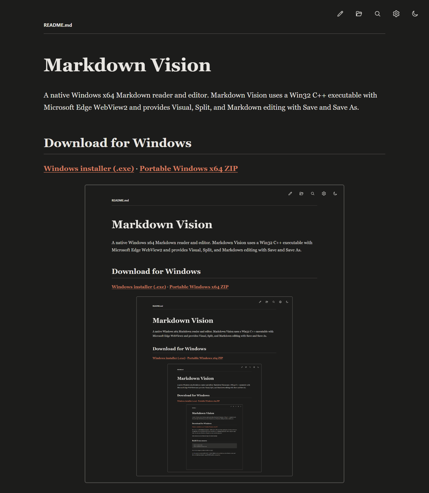

# Markdown Vision

A native Windows x64 Markdown reader and editor. The Win32 C++ app uses Microsoft Edge WebView2 and supports Visual, Split, and Markdown editing, saving, and system printing.

## Download for Windows

**[Windows installer (.exe)](https://github.com/wmarklloyd/Markdown-Vision/releases/download/v2.5.0/Markdown-Vision-Native-Setup-2.5.0.exe)** · **[Portable Windows x64 ZIP](https://github.com/wmarklloyd/Markdown-Vision/releases/download/v2.5.0/MarkdownVision-Native-Editor-2.5.0-win-x64.zip)**



Run setup to install `Markdown-Vision.exe`, add Markdown file associations, and register the Explorer Preview Pane handler. For the portable build, extract the ZIP and run `Markdown-Vision.exe` with the adjacent `web\` folder. You can pass a Markdown file path as a command-line argument.

Both downloads use the Microsoft Edge WebView2 Runtime.

## Build from source

```powershell
.\native-cpp\build.bat
.\native-cpp\build-installer.bat
```

The ZIP and setup executable are written to `dist\`.

See [the project description](PROJECT_DESCRIPTION.md) for architecture and verification status, and [the native build notes](native-cpp/README.md) for prerequisites.
